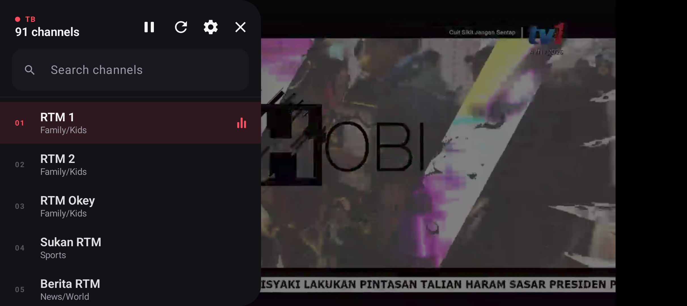

# TB

A small Android player for an M3U/M3U8 playlist hosted on GitHub.

Open the app and it starts playing the **first channel** in the playlist. Tap
anywhere on the video and the **channel list** slides in from the left. Pick
another channel and it starts immediately.

Built with Kotlin, Jetpack Compose and AndroidX Media3 (ExoPlayer). The playlist
is fetched from a raw GitHub URL on every launch, so updating the channel list
is just a GitHub commit — no app update required.

| Playing | Channel list |
| --- | --- |
|  |  |

## What it does

- **Launches straight into playback** — no home screen, no "press play".
- **Tap the video** to toggle the channel list (a side panel in landscape).
- **Search** the list by channel name or group.
- **Refresh** re-downloads the playlist without restarting the app.
- **HLS and DASH playback**, with **Widevine** licences and **ClearKey** keys
  read from `#KODIPROP` lines.
- **Locked to landscape** — the player never rotates into portrait.
- **Source** lets you paste a different raw URL for the current session. A cold
  launch always returns to the playlist URL compiled into the app.
- Keeps the last good playlist on disk, so the app still works if GitHub is
  temporarily unreachable (shows an "Offline copy" badge).
- Remembers playback across rotation and pauses when the app goes to the
  background.
- Cleartext HTTP is allowed because many IPTV endpoints still use it.

## Repo layout

```
TB/
├── app/                     Android app (Kotlin + Compose + Media3)
├── playlist/tb.m3u8         ← the playlist people edit on GitHub
├── .github/workflows/       builds a debug APK on every push
└── README.md
```

The app's default playlist URL is:

```
https://raw.githubusercontent.com/ZeeyKhm/TB/main/playlist/tb.m3u8
```

It is defined once in `app/build.gradle.kts` (`playlistUrl`). Change it there if
you rename the repo or move the file.

> If the `.m3u8` file is missing (for example during the rename from `.m3u`), the
> app automatically retries the same URL with the `.m3u` extension, so older
> copies of the playlist keep working.

## Update the channel list

1. Open `playlist/tb.m3u8` on GitHub and press the pencil (Edit) button.
2. Add or edit entries:

   ```m3u
   #EXTM3U
   #EXTINF:-1 tvg-id="channel-id" tvg-logo="https://…/logo.png" group-title="News",Channel name
   https://example.com/live/channel/index.m3u8
   ```

   - The **first** `#EXTINF` + URL pair is what opens on launch.
   - `group-title` is shown under the channel name and is searchable.
   - Comments (`# ...`) and blank lines are ignored.
   - Duplicate URLs are dropped.

3. Commit the change on `main`.
4. In the app, tap the video → **Refresh**.

> `raw.githubusercontent.com` sits behind a CDN that may serve a stale copy for a
> few minutes. The app appends a cache-busting query parameter on refresh, so a
> manual refresh gets the new file immediately.

## Build it yourself

Requirements:

- JDK 17+ (Android Studio's bundled JDK 21 works)
- Android SDK with **platform 36** and build-tools 36+
- Gradle comes from the wrapper (8.13)

Create `local.properties` with your SDK path (this file is git-ignored):

```properties
sdk.dir=C\:\\Users\\you\\AppData\\Local\\Android\\Sdk
```

Then:

```bat
gradlew.bat assembleDebug
```

The APK lands at `app/build/outputs/apk/debug/app-debug.apk`.

Run the parser unit tests with:

```bat
gradlew.bat testDebugUnitTest
```

### Point a test build at another playlist

```bat
gradlew.bat assembleDebug -PplaylistUrl=https://example.com/my-list.m3u8
```

This only changes the compiled-in default. A URL entered in the app's Source
dialog lasts until the app is closed; the next launch starts from the compiled-in
URL again.

## Install on a phone

With USB debugging enabled:

```bat
adb install -r app\build\outputs\apk\debug\app-debug.apk
```

Or copy the APK to the phone and open it (allow "install unknown apps" for your
file manager).

## GitHub setup (first time)

1. Create a **public** repository named `TB` on GitHub. Do not add a README,
   `.gitignore` or license — this project already has them.
2. From this folder, run:

   ```bat
   git remote add origin https://github.com/ZeeyKhm/TB.git
   git branch -M main
   git push -u origin main
   ```

3. Open the raw URL in a browser to confirm it returns the playlist:
   `https://raw.githubusercontent.com/ZeeyKhm/TB/main/playlist/tb.m3u8`
4. Install the APK. It will start with the first channel in that file.

The repository must be **public**. Raw GitHub URLs for private repos need a
token, and this app intentionally does not embed credentials.

## Notes and limitations

- HLS (`.m3u8`), DASH (`.mpd`) and progressive MP4/WebM are supported; raw
  MPEG-TS and RTMP streams are not.
- Widevine (`com.widevine.alpha`) and ClearKey (`org.w3.clearkey`) DRM are read
  from `#KODIPROP` lines. Widevine needs a licence server in the playlist and a
  device that supports Widevine (most Play-certified phones do).
- `#EXTVLCOPT:http-user-agent` / `http-referrer` values and `|Referer=` /
  `|User-Agent=` URL suffixes are applied to that channel's requests.
- No EPG, favorites, resume position or picture-in-picture yet.
- Always opens the first channel on a cold launch, by design, using the playlist
  URL compiled into the app.
- The activity is locked to landscape (`sensorLandscape`), so it flips between
  the two landscape sides but never shows portrait.
- The debug APK is signed with Android's debug key. For a Play Store release,
  add your own signing config and run `assembleRelease`.

## Legal

This project ships **no channels**. The playlist you load is your
responsibility: make sure you have the rights to watch and redistribute those
streams.
